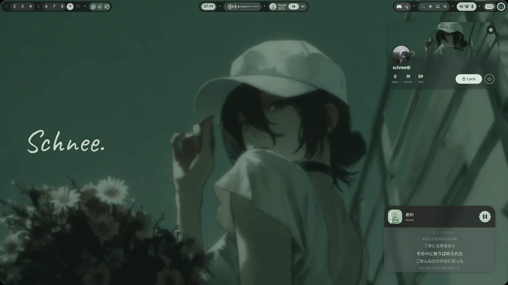
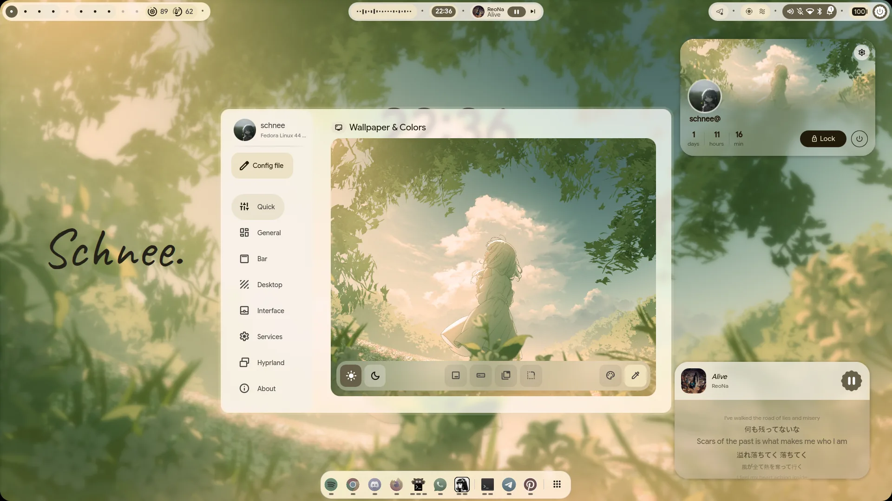
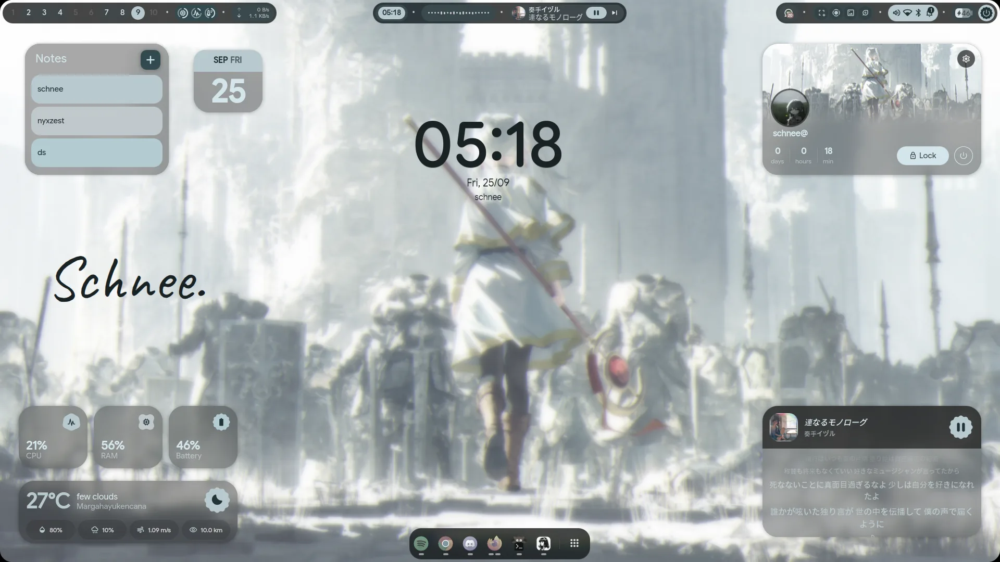
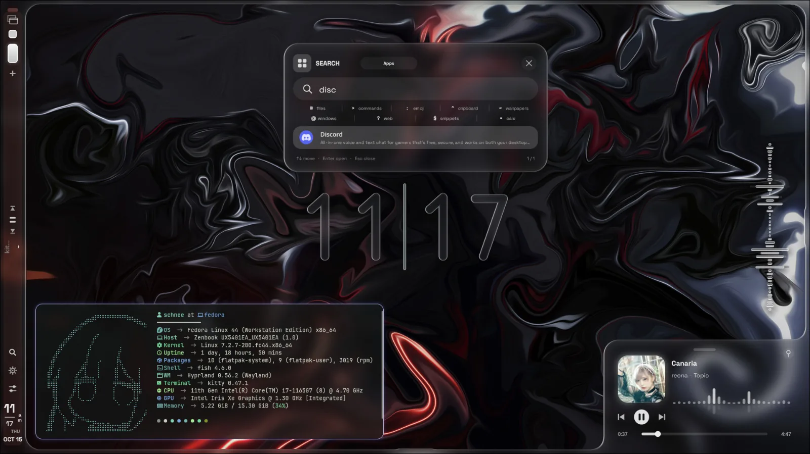
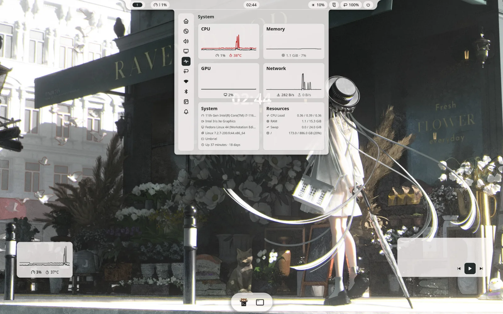

# schnee's dotfiles

Personal dotfiles for **Fedora Linux 44** running eight desktop rices across **Hyprland**, **Niri** and **Umbriel** — mostly Quickshell-family shells (end-4, Caelestia, iNiR, pleamar, Noctalia, minflair, Prism). Clean, minimalist frosted glassmorphism, tailored for productivity and gaming workflows.

## Showcase

### end4 — Hyprland + Quickshell (Material 3)

<p align="center">
  
  
</p>
<p align="center">
  
  
</p>

### Other rices

<p align="center">
  
  
</p>
<p align="center">
  
  
</p>

<p align="center">
  <sub>
    <b>caelestia</b> · Hyprland + Caelestia Quickshell &nbsp;•&nbsp;
    <b>vitreus</b> · Hyprland + pleamar &nbsp;•&nbsp;
    <b>noctalia</b> · Umbriel + Noctalia v5 &nbsp;•&nbsp;
    <b>iris</b> · Niri + iNiR
  </sub>
</p>

---

## Specifications

| Component | Specification |
| :--- | :--- |
| **OS** | Fedora Linux 44 (Workstation Edition) |
| **Kernel** | Linux 7.2.x x86_64 |
| **Compositors** | Hyprland (6 rices), Niri, Umbriel (Wayland) |
| **Shells** | Quickshell-family: end4-pC, Caelestia, II, minflair, Prism, iNiR, pleamar, Noctalia v5 |
| **Launcher** | Rofi 2.0 (Custom Launchpad Grid) |
| **Terminal** | Kitty with Fish shell & Starship prompt |
| **Laptop Hardware** | ASUS (TigerLake Intel Iris Xe GT2) |
| **Laptop Display** | 14-inch 2.8K 90Hz OLED (`eDP-1`, 1.6x scale) |
| **External Monitor** | Xiaomi Mi Desktop Monitor 1080p @ 200Hz (`HDMI-A-1`, 1.0x scale) |
| **Audio DAC** | Intel Tiger Lake-LP Smart Sound Technology (SOF) |
| **Mouse** | Ajazz AJ139 V2 MC (PAW3311, WebHID driver) |

---

## Repository Structure

```text
.
├── install.sh                  # Entry point: args, library loading, run order
├── lib/                        # Installer internals (one concern per file)
│   ├── core.sh                 # logging, atomic linking, backups, manifest
│   ├── snapshot.sh             # rollback snapshots
│   ├── backup.sh               # backup retention
│   ├── common.sh               # rice-independent configs + kitty wrapper
│   ├── rice.sh                 # dispatcher, foreign-link pruning, state folding
│   └── rices/                  # one linker per rice
├── bin/                        # dotfiles CLI, rice-switch, display switchers
├── tests/                      # Regression tests (rollback, doctor, kitty, …)
├── docs/                       # recovery guide
├── common/                     # Core configs shared across all rices
│   ├── kitty/                  # Terminal config + tracked fallback palette
│   ├── fish/                   # Fish shell config & aliases
│   ├── starship/               # Starship minimalist prompt
│   ├── rofi/                   # Launchpad & display switcher
│   ├── pipewire/               # Headphone DSP balance (+0.15 right channel)
│   ├── fastfetch/              # Custom ASCII logos & specs
│   ├── chrome/                 # Wallpaper color sync host
│   ├── firefox/                # WhiteSur frosted glass theme
│   ├── swappy/                 # Screenshot annotation config
│   ├── fontconfig/             # CJK & Nerd Font priorities
│   ├── sounds/                 # macOS UI feedback sounds (opus)
│   └── systemd/                # Background watcher services & timers
└── rices/                      # Isolated desktop rice environments
    ├── end4/                   # Hyprland + Quickshell end4-pC (Material 3)
    ├── caelestia/              # Hyprland + Caelestia Quickshell
    ├── ii-p3drovfx/            # Hyprland + Quickshell II (dynamic VFX)
    ├── minflair/               # Hyprland + Quickshell minflair
    ├── prism-shell/            # Hyprland + Quickshell Prism
    ├── vitreus/                # Hyprland + pleamar (liquid glass)
    ├── iris/                   # Niri + iNiR
    └── noctalia/               # Umbriel + Noctalia v5
```

Each rice carries `rice.conf` metadata plus its compositor config and shell state.

---

## Multi-Rice Architecture

### How a switch works

The repo is the source of truth; `~/.config` is a board of symlinks into it.
`common/` holds what every rice shares, `rices/<name>/` holds what differs, and
`lib/rices/<name>.sh` decides which of those files get linked for that rice.

`rice-switch <rice>` runs four steps in a fixed order:

| Step | What happens | On failure |
|---|---|---|
| 1. Link | `install.sh --rice <rice> --no-set-current` relinks configs | abort, nothing written |
| 2. Verify | `hyprland --verify-config` / `niri validate` / `umbriel config validate` | rollback snapshot restored |
| 3. Commit | write `~/.config/.current_rice`, set the GDM session | — |
| 4. Logout | quit the compositor; GDM starts the new session | — |

Step order is the safety property: a rice that cannot start never becomes the
recorded active rice, and the symlinks are already back on the previous rice
when the error is printed.

### The `dotfiles` CLI

```bash
dotfiles switch <rice>     # link → verify → set session → logout
dotfiles switch -n <rice>  # dry run: show the full plan, change nothing
dotfiles install <rice>    # relink only (no logout), e.g. Hyprland → Hyprland
dotfiles status            # active rice, compositor, GDM session, manifest size
dotfiles doctor            # verify every managed path against the manifest
dotfiles doctor --fix      # relink the active rice when drift is found
dotfiles diff              # repo changes vs generated state vs symlink drift
dotfiles save -m "msg"     # commit only generated/theme state
dotfiles rollback          # restore the last install snapshot
```

### Managed-path manifest

Every successful install writes `~/.local/state/dotfiles/manifest.tsv`
(`dest<TAB>src` per path). That is what `doctor` compares against, and it is the
only check that catches a shell rewriting a symlink into a regular file with an
atomic rename — the config silently stops tracking the repo otherwise.

`dotfiles doctor` exits 1 on missing/dangling/drifted/replaced paths and 0 when
the map is intact (leftover links from other rices are reported as notes, not
failures). Safe as a pre-commit or CI gate.

### Config vs generated state

| Kind | Examples | How it is committed |
|---|---|---|
| Hand-written config | `rices/*/hypr/*.lua`, `hypridle.conf`, `common/**` | normal commits |
| Generated theme/UI state | `rices/*/illogical-impulse/config.json` (end-4 shell state), `rices/*/hypr/hyprland/colors.lua` (Matugen palette) | `dotfiles save -m "..."` → `chore(state): ...` |

Keeping the two apart is why `git diff` stays readable: the state files churn on
every wallpaper change, hand-written config does not.

### Backups and rollback

- Replaced real files go to `~/.config/dotfiles_backup_<timestamp>/` with their
  original path preserved (`.config/hypr/...`), so two files with the same
  basename can never collide. The last 5 trees are kept.
- Before touching anything, the pre-state of each path (symlink target, or
  "real file") is written to `~/.local/state/dotfiles/rollback-<ts>-<pid>.tsv`.
  On failure the installer restores that snapshot; `install.sh --rollback`
  replays the last one on demand.
- Snapshots keep the previous manifest too, so a rollback also restores what
  `doctor` compares against.

Recovery runbook (black screen, wrong session, lost UI state):
[`docs/recovery.md`](docs/recovery.md).

### Switching rices

From a terminal or the keybinding menu:

```bash
rice-switch          # Open the Rofi/Fuzzel switcher (ACTIVE rice is marked)
rice-switch end4     # Switch to Hyprland Material 3
rice-switch iris     # Switch to Niri + iNiR
rice-switch --dry-run vitreus   # Show what a switch would link/verify, change nothing
rice-switch status   # Show the active rice, compositor and GDM session
```

### Shell forks

Two shells are cloned manually into `~/.config/quickshell/` and run from our own forks, so local patches survive upstream updates:

| Clone | Our fork | Upstream |
|---|---|---|
| `~/.config/quickshell/end4-pC` | `Schnee111/end4-pC` | `pctrade/end4-pC` |
| `~/.config/quickshell/inir` | `Schnee111/iNiR` | `snowarch/iNiR` |

What the iNiR fork carries (see `git log` in the clone):

- `fix(config)` — every config resolver is pinned to `~/.config/inir`; the fallback to `~/.config/illogical-impulse` (end4's path) is gone, so the two shells no longer overwrite each other's state.
- `fix(iris)` — `BackgroundEffect` guards in `IrisBlurRegion`/`IrisWaveBlur`, and the explicit radius on the child regions dropped.
- `fix(shell)` — `DefaultEnv` pragmas changed to `Env` (Quickshell 0.2.1 does not accept the former) plus a panel-family fallback from the config.

Updating upstream:

```bash
cd ~/.config/quickshell/inir
git fetch upstream && git merge upstream/main   # resolve the patch conflicts, then git push
```

### Adding a new rice

1. Create a directory under `rices/<rice-name>/`.
2. Add `rice.conf` metadata:
   ```bash
   NAME="rice-name"
   DISPLAY_NAME="🎨  Rice Name (Hyprland / Waybar)"
   COMPOSITOR="hyprland"
   ```
3. Put the compositor and shell configuration inside it (e.g. `hypr/`, `waybar/`, `dunst/`).
4. Run `rice-switch` — the new profile is picked up automatically.

### Terminal theming (kitty)

`~/.config/kitty/kitty.conf` is **not** symlinked into the repo; `install.sh` generates it per rice:

```text
~/.config/kitty/kitty.conf          # generated: include common/kitty/kitty.conf
~/.config/kitty/rice-theme.conf     # symlink to the active rice's theme
```

The reason is that rice shells write `include` lines into `kitty.conf` at runtime — iNiR (`generate_terminal_configs.py`) appends `include current-theme.conf` at EOF, i.e. after `background_opacity 0.50` + `dynamic_background_opacity yes`, so the theme's opaque background turns the glass off. With the file symlinked into the repo those writes land in a tracked file, dirtying the tree every iris session. The generated wrapper absorbs them and is rewritten on the next switch, so they disappear.

| Rice | Theme source |
|---|---|
| `end4`, `ii-p3drovfx` | `~/.local/state/quickshell/user/generated/terminal/kitty-theme.conf` |
| `iris` | `~/.config/kitty/theme.conf` |
| everything else | `common/kitty/default-theme.conf` (tracked fallback palette) |

Edit the base colours in `common/kitty/kitty.conf` and the fallback palette in `common/kitty/default-theme.conf`. The rice → theme mapping lives in `kitty_theme_source()` in `lib/common.sh`; `tests/kitty-theme-ownership.sh` asserts the invariants.

---

## Installation

### 1. Clone the repository
```bash
git clone https://github.com/Schnee111/dotfiles.git ~/Projects/dotfiles
cd ~/Projects/dotfiles
```

### 2. Preview changes (Dry Run)
```bash
./install.sh --dry-run
```

### 3. Install & Symlink
```bash
./install.sh
```
What the installer guarantees:

- existing real files are **moved**, never deleted, into
  `~/.config/dotfiles_backup_<timestamp>/` with their path preserved;
- every symlink is replaced atomically (`ln -sf` + `mv -T`), so no reader ever
  sees a half-written config;
- each touched path is recorded first, and a failed run rolls itself back;
- the managed-path list is written to `~/.local/state/dotfiles/manifest.tsv`
  for `dotfiles doctor`;
- the last 5 backup trees are kept, older ones are pruned.

### 4. Verify
```bash
dotfiles doctor
```

After installing on a new account, adjust the user-data paths stored in the
shell configs (wallpaper, download and recording folders in
`rices/*/illogical-impulse/config.json` and `rices/iris/inir/config.json`);
they still point at the original author's home directory.

### Optional: ASUS power controls
The battery-limit and power-profile toggles need write access to ASUS sysfs
nodes. `sudo ./setup_power_permissions.sh` creates an `asus-power` group, adds
the invoking user to it (log out and back in afterwards) and installs a udev
rule, a tmpfiles entry and a boot service that make those nodes `0664
root:asus-power`. Only group members can change them. It is a one-time,
ASUS-only step and the installer never runs it. If an older version of the
script installed `/etc/polkit-1/rules.d/90-asus-power.rules` or made the nodes
world-writable (`0666`), re-running the script removes the rule and tightens
the nodes.

---

## Development

```bash
bash tests/run.sh                                        # syntax, lint and regression tests
bash tests/shell-lint.sh                                 # just `bash -n` + ShellCheck on every tracked script
bash tests/network/check-pins.sh                         # pinned third-party shells still fetchable (needs network)
./install.sh --dry-run --rice <rice>                     # what a link pass would do
```

`tests/shell-lint.sh` checks every tracked `.sh`, `bin/*` and `.githooks/*` (vendored
scripts under `rices/*/hypr/hyprland/scripts/` are skipped). Enable the pre-commit hook,
which just runs `tests/run.sh`, with `git config core.hooksPath .githooks`.

CI (`.github/workflows/ci.yml`) runs the same test suite (so ShellCheck and `bash -n`
included) and a dry-run link pass for every rice on each push.

---

## License

[GPL-3.0](LICENSE). The Hyprland modules under `rices/end4/` and `rices/ii-p3drovfx/` derive
from [end-4/dots-hyprland](https://github.com/end-4/dots-hyprland), which is GPL-3.0, so the
repository as a whole is distributed under the same terms.

Vendored files keep their own licenses: for example the Apache-2.0
`show-loaded-ollama-models.sh` under `rices/*/hypr/hyprland/scripts/ai/` carries its license
text next to it. The shells the installer fetches (Quickshell configurations, Vitreus,
end4-pC, ...) are separate projects under their own licenses and are not part of this
repository.

---

## Credits

- [end-4/dots-hyprland](https://github.com/end-4/dots-hyprland) for the base framework.
- [Quickshell](https://outfoxxed.me/quickshell/) for the reactive desktop widget environment.
- [Material You / Matugen](https://github.com/InioX/matugen) for automatic color palette generation.
