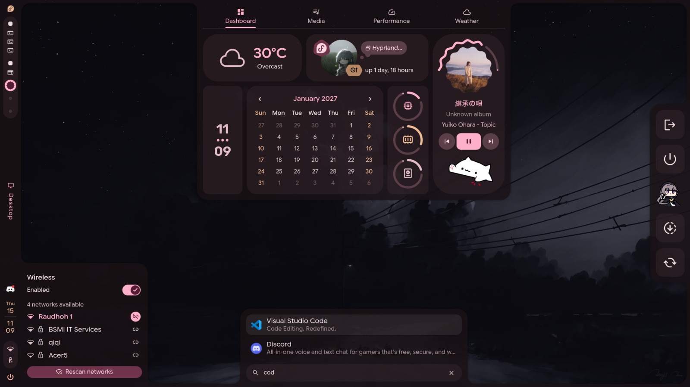
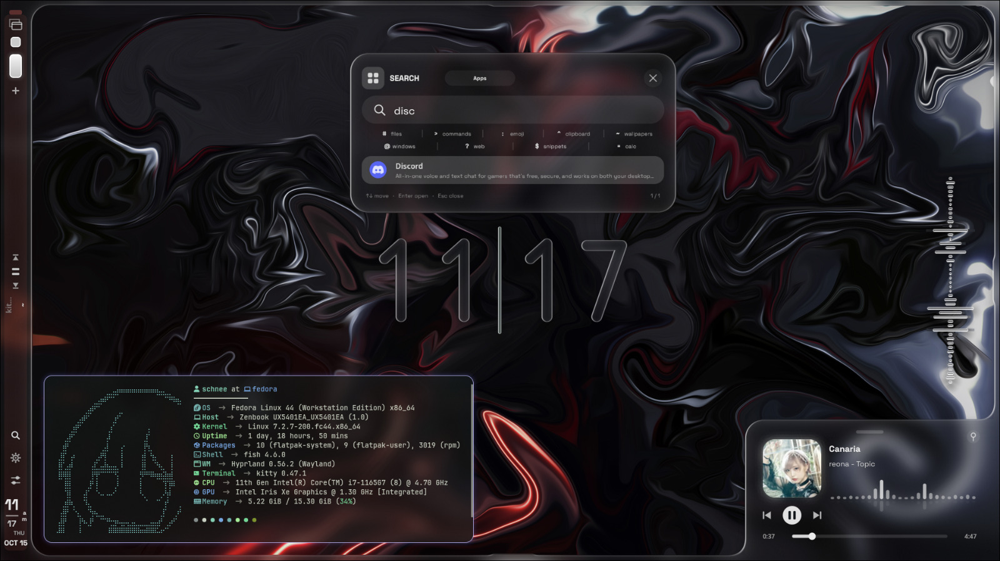
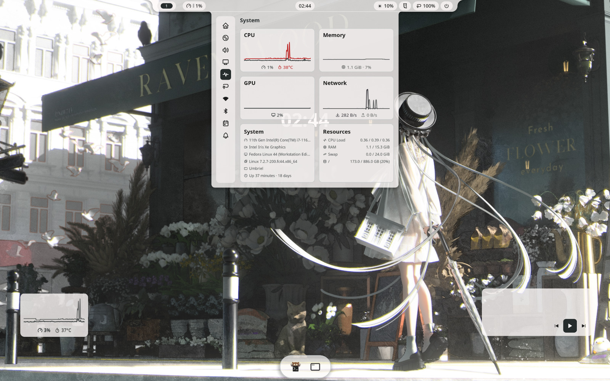
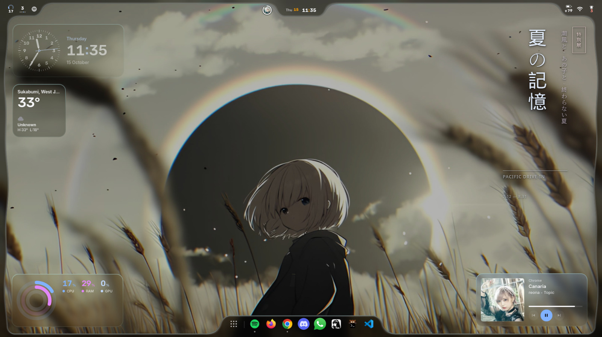

# schnee's dotfiles

Personal dotfiles for **Fedora Linux 44** running eight desktop rices across **Hyprland**, **Niri** and **Umbriel** — mostly Quickshell-family shells (end-4, Caelestia, iNiR, pleamar, Noctalia, minflair, Prism). Clean, minimalist frosted glassmorphism, tailored for productivity and gaming workflows.

## Showcase

### end4 — Hyprland + Quickshell (Material 3)

<p align="center">
  
  
</p>
<p align="center">
  
  
</p>

### Other rices

<p align="center">
  
  
</p>
<p align="center">
  
  
</p>

<p align="center">
  <sub>
    <b>caelestia</b> · Hyprland + Caelestia Quickshell &nbsp;•&nbsp;
    <b>vitreus</b> · Hyprland + pleamar &nbsp;•&nbsp;
    <b>noctalia</b> · Umbriel + Noctalia v5 &nbsp;•&nbsp;
    <b>iris</b> · Niri + iNiR
  </sub>
</p>

---

## Specifications

| Component | Specification |
| :--- | :--- |
| **OS** | Fedora Linux 44 (Workstation Edition) |
| **Kernel** | Linux 7.2.x x86_64 |
| **Compositors** | Hyprland (6 rices), Niri, Umbriel (Wayland) |
| **Shells** | Quickshell-family: end4-pC, Caelestia, II, minflair, Prism, iNiR, pleamar, Noctalia v5 |
| **Launcher** | Rofi 2.0 (Custom Launchpad Grid) |
| **Terminal** | Kitty with Fish shell & Starship prompt |
| **Laptop Hardware** | ASUS (TigerLake Intel Iris Xe GT2) |
| **Laptop Display** | 14-inch 2.8K 90Hz OLED (`eDP-1`, 1.6x scale) |
| **External Monitor** | Xiaomi Mi Desktop Monitor 1080p @ 200Hz (`HDMI-A-1`, 1.0x scale) |
| **Audio DAC** | Intel Tiger Lake-LP Smart Sound Technology (SOF) |
| **Mouse** | Ajazz AJ139 V2 MC (PAW3311, WebHID driver) |

---

## Repository Structure

```text
.
├── install.sh                  # Automated installer & multi-rice linker
├── bin/                        # rice-switch, display switchers, helper CLIs
├── tests/                      # Regression tests for the installer
├── common/                     # Core configs shared across all rices
│   ├── kitty/                  # Terminal config + tracked fallback palette
│   ├── fish/                   # Fish shell config & aliases
│   ├── starship/               # Starship minimalist prompt
│   ├── rofi/                   # Launchpad & display switcher
│   ├── pipewire/               # Headphone DSP balance (+0.15 right channel)
│   ├── fastfetch/              # Custom ASCII logos & specs
│   ├── chrome/                 # Wallpaper color sync host
│   ├── firefox/                # WhiteSur frosted glass theme
│   ├── swappy/                 # Screenshot annotation config
│   ├── fontconfig/             # CJK & Nerd Font priorities
│   └── systemd/                # Background watcher services & timers
└── rices/                      # Isolated desktop rice environments
    ├── end4/                   # Hyprland + Quickshell end4-pC (Material 3)
    ├── caelestia/              # Hyprland + Caelestia Quickshell
    ├── ii-p3drovfx/            # Hyprland + Quickshell II (dynamic VFX)
    ├── minflair/               # Hyprland + Quickshell minflair
    ├── prism-shell/            # Hyprland + Quickshell Prism
    ├── vitreus/                # Hyprland + pleamar (liquid glass)
    ├── iris/                   # Niri + iNiR
    └── noctalia/               # Umbriel + Noctalia v5
```

Each rice carries `rice.conf` metadata plus its compositor config and shell state.

---

## Multi-Rice Architecture

### Switching rices

From a terminal or the keybinding menu:

```bash
rice-switch          # Open the Fuzzel-based switcher
rice-switch end4     # Switch to Hyprland Material 3
rice-switch iris     # Switch to Niri + iNiR
rice-switch status   # Show the active rice and compositor
```

### Shell forks

Two shells are cloned manually into `~/.config/quickshell/` and run from our own forks, so local patches survive upstream updates:

| Clone | Our fork | Upstream |
|---|---|---|
| `~/.config/quickshell/end4-pC` | `Schnee111/end4-pC` | `pctrade/end4-pC` |
| `~/.config/quickshell/inir` | `Schnee111/iNiR` | `snowarch/iNiR` |

What the iNiR fork carries (see `git log` in the clone):

- `fix(config)` — every config resolver is pinned to `~/.config/inir`; the fallback to `~/.config/illogical-impulse` (end4's path) is gone, so the two shells no longer overwrite each other's state.
- `fix(iris)` — `BackgroundEffect` guards in `IrisBlurRegion`/`IrisWaveBlur`, and the explicit radius on the child regions dropped.
- `fix(shell)` — `DefaultEnv` pragmas changed to `Env` (Quickshell 0.2.1 does not accept the former) plus a panel-family fallback from the config.

Updating upstream:

```bash
cd ~/.config/quickshell/inir
git fetch upstream && git merge upstream/main   # resolve the patch conflicts, then git push
```

### Adding a new rice

1. Create a directory under `rices/<rice-name>/`.
2. Add `rice.conf` metadata:
   ```bash
   NAME="rice-name"
   DISPLAY_NAME="🎨  Rice Name (Hyprland / Waybar)"
   COMPOSITOR="hyprland"
   ```
3. Put the compositor and shell configuration inside it (e.g. `hypr/`, `waybar/`, `dunst/`).
4. Run `rice-switch` — the new profile is picked up automatically.

### Terminal theming (kitty)

`~/.config/kitty/kitty.conf` is **not** symlinked into the repo; `install.sh` generates it per rice:

```text
~/.config/kitty/kitty.conf          # generated: include common/kitty/kitty.conf
~/.config/kitty/rice-theme.conf     # symlink to the active rice's theme
```

The reason is that rice shells write `include` lines into `kitty.conf` at runtime — iNiR (`generate_terminal_configs.py`) appends `include current-theme.conf` at EOF, i.e. after `background_opacity 0.50` + `dynamic_background_opacity yes`, so the theme's opaque background turns the glass off. With the file symlinked into the repo those writes land in a tracked file, dirtying the tree every iris session. The generated wrapper absorbs them and is rewritten on the next switch, so they disappear.

| Rice | Theme source |
|---|---|
| `end4`, `ii-p3drovfx` | `~/.local/state/quickshell/user/generated/terminal/kitty-theme.conf` |
| `iris` | `~/.config/kitty/theme.conf` |
| everything else | `common/kitty/default-theme.conf` (tracked fallback palette) |

Edit the base colours in `common/kitty/kitty.conf` and the fallback palette in `common/kitty/default-theme.conf`. The rice → theme mapping lives in `kitty_theme_source()` in `install.sh`; `tests/kitty-theme-ownership.sh` asserts the invariants.

---

## Installation

### 1. Clone the repository
```bash
git clone https://github.com/Schnee111/dotfiles.git ~/Projects/dotfiles
cd ~/Projects/dotfiles
```

### 2. Preview changes (Dry Run)
```bash
./install.sh --dry-run
```

### 3. Install & Symlink
```bash
./install.sh
```
*Note: existing configuration files are backed up to `~/.config/dotfiles_backup_<timestamp>/` before the symlinks are created.*

---

## Credits

- [end-4/dots-hyprland](https://github.com/end-4/dots-hyprland) for the base framework.
- [Quickshell](https://outfoxxed.me/quickshell/) for the reactive desktop widget environment.
- [Material You / Matugen](https://github.com/InioX/matugen) for automatic color palette generation.
