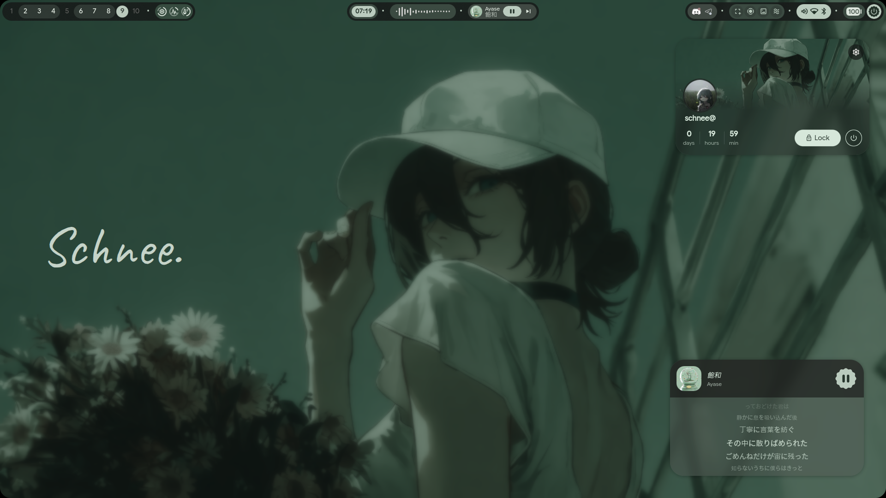
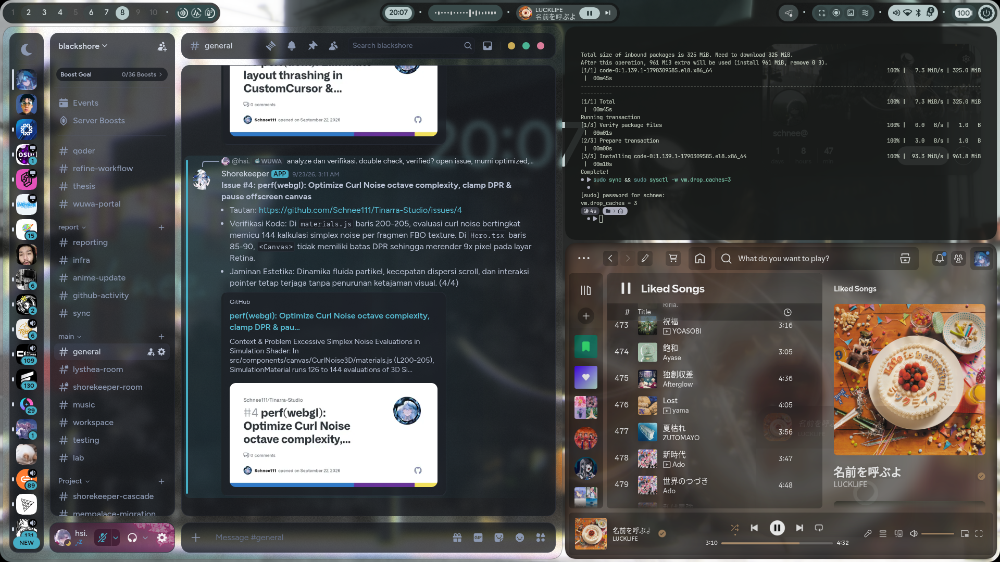

# schnee's dotfiles

Personal dotfiles and configurations for **Fedora Linux 44** running **Hyprland** with **Quickshell** (Material 3 / end-4 framework). Crafted with a clean, minimalist frosted glassmorphism aesthetic tailored for productivity and gaming workflows.

## Showcase

<p align="center">
  
  
</p>
<p align="center">
  
  
</p>

---

## Specifications

| Component | Specification |
| :--- | :--- |
| **OS** | Fedora Linux 44 (Workstation Edition) |
| **Kernel** | Linux 7.2.x x86_64 |
| **Compositor** | Hyprland (Wayland) |
| **Shell / Widgets** | Quickshell (end4-pC / Material 3) |
| **Launcher** | Rofi 2.0 (Custom Launchpad Grid) |
| **Terminal** | Kitty with Fish shell & Starship prompt |
| **Laptop Hardware** | ASUS (TigerLake Intel Iris Xe GT2) |
| **Laptop Display** | 14-inch 2.8K 90Hz OLED (`eDP-1`, 1.5x scale) |
| **External Monitor** | Xiaomi Mi Desktop Monitor 1080p @ 200Hz (`HDMI-A-1`, 1.0x scale) |
| **Audio DAC** | Intel Tiger Lake-LP Smart Sound Technology (SOF) |
| **Mouse** | Ajazz AJ139 V2 MC (PAW3311, WebHID driver) |

---

## Repository Structure

```text
.
├── install.sh                  # Automated installer & multi-rice linker
├── bin/
│   └── rice-switch             # Dynamic Fuzzel-based rice switcher
├── common/                     # Core configs shared across all rices
│   ├── kitty/                  # Terminal emulator config
│   ├── fish/                   # Fish shell config & aliases
│   ├── starship/               # Starship minimalist prompt
│   ├── rofi/                   # Launchpad & display switcher
│   ├── pipewire/               # Headphone DSP balance (+0.15 right channel)
│   ├── fastfetch/              # Custom ASCII logos & specs
│   ├── chrome/                 # Wallpaper color sync host
│   ├── firefox/                # WhiteSur frosted glass theme
│   ├── swappy/                 # Screenshot annotation config
│   ├── fontconfig/             # CJK & Nerd Font priorities
│   └── systemd/                # Background watcher services & timers
└── rices/                      # Isolated desktop rice environments
    ├── end4/                   # Rice 1: Hyprland + Quickshell (Material 3)
    │   ├── rice.conf           # Profile metadata
    │   ├── hypr/               # Hyprland custom configs, rules & scripts
    │   └── illogical-impulse/  # Quickshell bar, dock & widget state
    └── iris/                   # Rice 2: Niri + iNiR
        ├── rice.conf           # Profile metadata
        ├── niri/               # Niri config (config.kdl)
        └── inir/               # iNiR Quickshell state
```

---

## Multi-Rice Architecture

### Switching Rices
Bisa via terminal atau shortcut:
```bash
rice-switch          # Membuka GUI menu switcher (Fuzzel)
rice-switch end4     # Beralih ke Hyprland Material 3
rice-switch iris     # Beralih ke Niri iNiR
rice-switch status   # Cek rice & compositor aktif
```

### Menambahkan Rice Baru
1. Buat folder baru di bawah `rices/<nama-rice>/`.
2. Tambahkan `rice.conf` (metadata opsional):
   ```bash
   NAME="nama-rice"
   DISPLAY_NAME="🎨  Nama Rice (Hyprland / Waybar)"
   COMPOSITOR="hyprland"
   ```
3. Letakkan konfigurasi WM/Shell di dalamnya (misal `hypr/`, `waybar/`, `dunst/`).
4. Jalankan `rice-switch` — profil baru akan otomatis terdeteksi di menu!

---

## Installation

### 1. Clone the repository
```bash
git clone https://github.com/Schnee111/dotfiles.git ~/Projects/dotfiles
cd ~/Projects/dotfiles
```

### 2. Preview changes (Dry Run)
```bash
./install.sh --dry-run
```

### 3. Install & Symlink
```bash
./install.sh
```
*Note: Existing configuration files will automatically be backed up to `~/.config/dotfiles_backup_<timestamp>/` before creating symbolic links.*

---

## Credits

- [end-4/dots-hyprland](https://github.com/end-4/dots-hyprland) for the base framework.
- [Quickshell](https://outfoxxed.me/quickshell/) for the reactive desktop widget environment.
- [Material You / Matugen](https://github.com/InioX/matugen) for automatic color palette generation.
